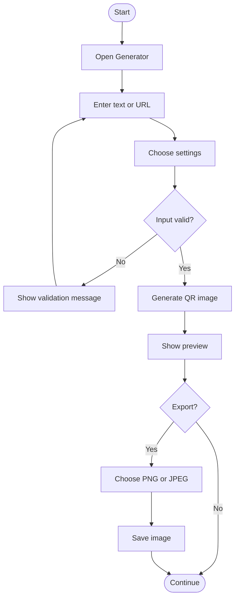
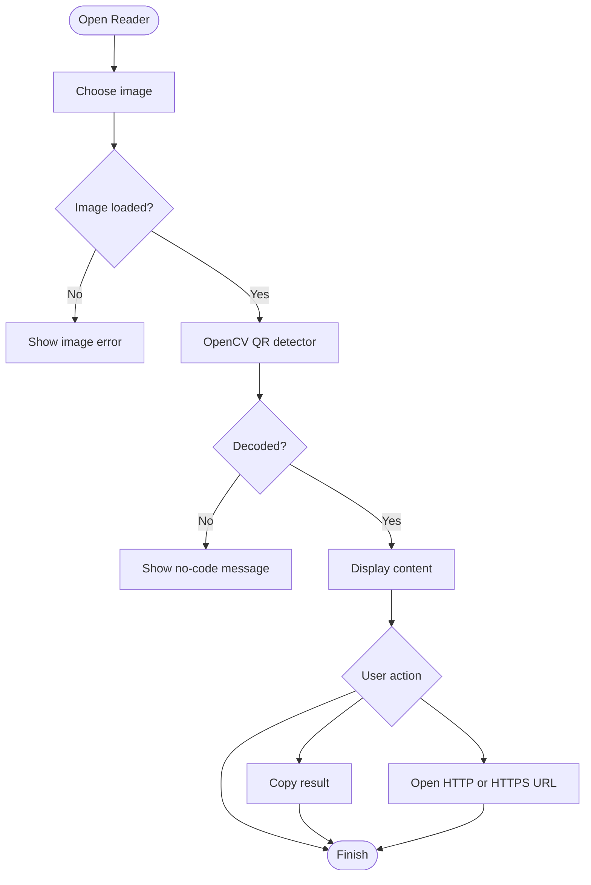

# ✨ QR Code Studio

<div align="center">

### Generate · Customize · Decode · Organize

A feature-rich Python desktop QR code generator and reader.

[](https://www.python.org/)
[](https://docs.python.org/3/library/tkinter.html)
[](https://python-pillow.org/)
[](https://opencv.org/)
[](LICENSE)

**A local-first desktop toolkit for creating customized QR codes and decoding QR images.**

[Features](#-features) · [Installation](#-installation) · [Usage](#-how-to-use) · [Architecture](#-project-architecture) · [Roadmap](#-roadmap)

</div>

---

## 📚 Table of Contents

- [About](#-about)
- [Features](#-features)
- [Application Preview](#-application-preview)
- [Technology Stack](#-technology-stack)
- [Project Architecture](#-project-architecture)
- [Requirements](#-requirements)
- [Installation](#-installation)
- [Run the Application](#-run-the-application)
- [How to Use](#-how-to-use)
- [QR Error Correction](#-qr-error-correction)
- [Supported Content](#-supported-content)
- [Configuration](#-configuration)
- [Application Workflow](#-application-workflow)
- [Code Overview](#-code-overview)
- [Privacy and Security](#-privacy-and-security)
- [Troubleshooting](#-troubleshooting)
- [Testing Checklist](#-testing-checklist)
- [Known Limitations](#-known-limitations)
- [Roadmap](#-roadmap)
- [Contributing](#-contributing)
- [FAQ](#-frequently-asked-questions)
- [License](#-license)
- [Acknowledgements](#-acknowledgements)
- [Author](#-author)

---

## 🌟 About

**QR Code Studio** is a Python desktop application that brings QR code generation and image-based QR decoding into one graphical interface.

Enter text or a URL, customize the QR appearance, preview the result, and export it as an image. You can also load an existing image and decode its QR content.

The codebase is split into focused modules so the interface, generation logic, decoding logic, and shared utilities can be developed independently.

### Project goals

- Make QR generation straightforward through a desktop GUI.
- Provide useful visual and error-correction settings.
- Decode QR codes from local image files.
- Keep a local history of recently generated codes.
- Demonstrate modular Python application development.
- Perform core generation and decoding locally, without a hosted QR service.

> **Project type:** Desktop application  
> **Language:** Python  
> **GUI:** Tkinter  
> **History storage:** Local JSON file

---

## 🚀 Features

### QR generation

- Generate QR codes from text, URLs, email text, phone text, and other strings.
- Automatically fit the QR version to the supplied content.
- Preview the generated QR image in the application.
- Validate empty input before generation.
- Configure QR error correction.

### Visual customization

- Select foreground color.
- Select background color.
- Adjust module size.
- Adjust quiet-zone border.
- Preview the generated image before export.

### Image export

- Save QR codes as PNG.
- Save QR codes as JPEG.
- Choose the destination with a native save dialog.
- Convert to RGB when required for JPEG export.

### QR reader

- Select a local image using a file dialog.
- Decode QR content using OpenCV.
- Display the decoded text.
- Show a helpful message if no readable QR code is detected.

### Clipboard and browser actions

- Copy decoded content to the clipboard.
- Open decoded HTTP and HTTPS links in the default browser.
- Avoid treating arbitrary decoded text as a web URL.

### Local history

- Record recent QR generations.
- Store history in `history.json`.
- Display timestamp, content preview, and saved path.
- Open a saved QR image when its recorded path is still valid.
- Keep a bounded list of recent entries.

### Desktop experience

- Tab-based interface.
- Dark visual theme.
- Separate Generator, Reader, and History workspaces.
- Clear labels, action buttons, and feedback dialogs.
- Modular source code.

---

## 🖼️ Application Preview

The application has three primary workspaces:

| Workspace | Purpose |
|---|---|
| **Generator** | Enter content, configure settings, preview and export QR codes |
| **Reader** | Select an image and decode its QR content |
| **History** | Review recent generations and open saved files |

### Add screenshots

Capture the running application and place screenshots in the `assets/` folder:

```text
assets/
├── generator-preview.png
├── reader-preview.png
└── history-preview.png
```

Then add them to this README:

```md


```

Use genuine screenshots from your own application rather than placeholder images. A generator screenshot with a QR preview is an excellent first image for the GitHub repository.

---

## 🧰 Technology Stack

| Technology | Purpose |
|---|---|
| **Python 3** | Core programming language |
| **Tkinter** | Desktop graphical interface |
| **qrcode** | QR code generation |
| **Pillow** | Image preview, conversion, and export |
| **OpenCV** | QR detection and decoding |
| **JSON** | Local generation history |
| **webbrowser** | Open decoded web links |
| **os / sys / subprocess** | File paths and operating-system integration |

### Why these tools?

- **Python** keeps the application readable and approachable.
- **Tkinter** provides a native desktop GUI without a separate web frontend.
- **qrcode** creates QR matrices and renders them as images.
- **Pillow** handles image objects and export formats.
- **OpenCV** detects and decodes QR codes from image files.

---

## 🗂️ Project Architecture

```text
qr-code-studio/
│
├── main.py                 # Application entry point
├── app.py                  # Tkinter interface and event handling
├── generator.py             # QR generation service
├── reader.py                # QR decoding service
├── utils.py                 # Shared paths and OS helpers
├── requirements.txt         # Python dependencies
├── README.md                # Project documentation
├── .gitignore               # Git exclusions
│
├── assets/                  # Optional icons and screenshots
└── generated_qr/            # Output directory for future extensions
```

### Module responsibilities

| File | Responsibility |
|---|---|
| `main.py` | Creates the application and starts the event loop |
| `app.py` | Builds the GUI and connects user actions to services |
| `generator.py` | Creates QR images from content and settings |
| `reader.py` | Loads image files and decodes QR content |
| `utils.py` | Provides shared paths and file/browser helpers |
| `requirements.txt` | Lists external packages |

### Design approach

1. The GUI collects input and settings.
2. The GUI calls the appropriate service.
3. The service generates or decodes QR content.
4. The GUI displays the result.
5. Shared utilities handle file and operating-system operations.

This keeps the core QR logic separate from Tkinter widgets.

---

## 📋 Requirements

### Software

- Windows, macOS, or Linux.
- Python 3.9 or later recommended.
- pip package installer.
- Tkinter support in the Python installation.
- VS Code or another editor (optional).

### Python packages

```text
qrcode[pil]>=7.4.2
Pillow>=10.0.0
opencv-python>=4.8.0
```

### Hardware

The application is lightweight and should run on a typical modern laptop or desktop. A webcam is **not** required because the current reader works with image files.

---

## ⚙️ Installation

### 1. Clone the repository

Replace `YOUR_USERNAME` with your GitHub username:

```bash
git clone https://github.com/YOUR_USERNAME/qr-code-studio.git
cd qr-code-studio
```

### 2. Check Python

```powershell
python --version
```

On some systems:

```bash
python3 --version
```

### 3. Create a virtual environment

**Windows:**

```powershell
python -m venv .venv
```

**macOS / Linux:**

```bash
python3 -m venv .venv
```

A virtual environment isolates project dependencies from other Python applications.

### 4. Activate the environment

**Windows PowerShell:**

```powershell
.venv\Scripts\Activate.ps1
```

**Windows Command Prompt:**

```bat
.venv\Scriptsctivate.bat
```

**macOS / Linux:**

```bash
source .venv/bin/activate
```

The terminal should show `(.venv)` when activation succeeds.

### 5. Upgrade pip

```bash
python -m pip install --upgrade pip
```

### 6. Install dependencies

```bash
python -m pip install -r requirements.txt
```

### 7. Verify dependencies

```bash
python -m pip show qrcode
python -m pip show Pillow
python -m pip show opencv-python
```

### 8. Verify Tkinter

```bash
python -m tkinter
```

A small test window should appear if Tkinter is installed correctly.

> **Linux note:** Some distributions package Tkinter separately. Install the distribution's Tk support package if the test reports that Tkinter is missing.

---

## ▶️ Run the Application

With the virtual environment activated and the terminal inside the project folder, run:

```bash
python main.py
```

The QR Code Studio window should open.

### Windows quick start

```powershell
cd D:\path\to\qr-code-studio
.venv\Scripts\Activate.ps1
python main.py
```

### macOS / Linux quick start

```bash
cd /path/to/qr-code-studio
source .venv/bin/activate
python main.py
```

Close the application window to stop the Tkinter event loop.

---

## 🧭 How to Use

### 1. Generate a QR code

1. Launch the application.
2. Open the **Generator** tab.
3. Enter text or a URL.
4. Choose an error-correction level.
5. Adjust module size and border if required.
6. Select **GENERATE QR**.
7. Review the preview.

Example:

```text
https://www.github.com
```

The QR code stores the supplied content. It does not create or host a website.

### 2. Customize the QR code

| Setting | Description |
|---|---|
| Foreground | Color of the QR modules |
| Background | Color behind the modules |
| Module size | Pixel size of each QR module |
| Border | Quiet-zone width around the code |
| Error correction | Redundancy level encoded in the QR |

**Scanning advice:** Prefer a dark foreground on a light background, preserve the quiet zone, and test the final image with a phone camera.

### 3. Save a QR code

1. Generate a QR code.
2. Select **Save PNG** or **Save JPG**.
3. Choose a destination.
4. Enter a filename.
5. Confirm the save dialog.

PNG is generally preferable because it preserves crisp edges. JPEG is available for compatibility, but compression artifacts may reduce scan reliability.

### 4. Read a QR code

1. Open the **Reader** tab.
2. Select **CHOOSE IMAGE**.
3. Choose an image containing a QR code.
4. Review the decoded content.

If decoding fails, try a sharper, larger, higher-contrast image.

### 5. Copy decoded content

Select **COPY RESULT** after successfully decoding an image. Paste the result into another application.

### 6. Open a decoded URL

Select **OPEN URL** only after checking that the decoded HTTP or HTTPS link is trustworthy. QR codes can contain deceptive destinations.

### 7. View generation history

Open the **History** tab to review recent generations. Select an entry and use **OPEN SELECTED FILE** if a saved file path exists and the file is still available.

History is stored locally in `history.json`.

---

## 🛡️ QR Error Correction

QR codes include error-correction information that can help recover data when part of a code is damaged or obscured.

| Level | Approximate recovery capability | General guidance |
|---|---:|---|
| **L** | 7% | Lower redundancy |
| **M** | 15% | Balanced general-purpose option |
| **Q** | 25% | Higher recovery capability |
| **H** | 30% | Highest recovery capability |

These percentages are approximate restoration capabilities, not a guarantee that a code will scan if that exact percentage is covered.

### Choosing a level

- Start with **M** for ordinary URLs.
- Consider **Q** or **H** when extra damage tolerance is useful.
- Higher correction levels can make the QR code denser.
- Dense codes may need larger output dimensions.

### Practical scanning tips

- Keep a clear quiet zone.
- Use sufficient image resolution.
- Avoid stretching the QR image.
- Maintain strong contrast.
- Test important codes before printing or distribution.

---

## 🔗 Supported Content

The generator accepts text. Common examples include:

| Content type | Example |
|---|---|
| Website | `https://example.com` |
| GitHub profile | `https://github.com/username` |
| LinkedIn profile | `https://www.linkedin.com/in/username/` |
| Plain text | `Hello from QR Code Studio!` |
| Email text | `mailto:hello@example.com` |
| Phone text | `tel:+1234567890` |

These are examples of strings that can be encoded. The application does not validate every URL or guarantee that a destination exists.

---

## 🎨 Configuration

### Default colors

The initial foreground and background colors are set in `app.py`:

```python
self.fg_color = "#111827"
self.bg_color = "#ffffff"
```

### Default QR settings

The generator controls are initialized in `app.py`:

```python
self.error_var = tk.StringVar(value="M")
self.box_var = tk.IntVar(value=10)
self.border_var = tk.IntVar(value=4)
```

### Window dimensions

```python
self.root.geometry("1100x760")
self.root.minsize(900, 650)
```

### Theme colors

The main theme values are defined near the top of `app.py`:

```python
BG = "#101827"
PANEL = "#182438"
PANEL2 = "#202f46"
TEXT = "#edf3fc"
MUTED = "#9aabc2"
ACCENT = "#61d5c4"
ACCENT2 = "#8b9cff"
```

Use valid hexadecimal color values when customizing the theme.

---

## 🔄 Application Workflow

### QR generation



### QR reading



The diagrams describe the current application workflow; they do not imply that webcam scanning or other roadmap features are already implemented.

---

## 🧩 Code Overview

### `main.py`

The entry point creates the application and starts the Tkinter event loop:

```python
from app import QRCodeStudio

if __name__ == "__main__":
    QRCodeStudio().run()
```

### `generator.py`

The generation service accepts content and QR configuration values. It creates a QR object, adds the data, fits the version, and returns a Pillow image.

```python
import qrcode
from qrcode.constants import (
    ERROR_CORRECT_L,
    ERROR_CORRECT_M,
    ERROR_CORRECT_Q,
    ERROR_CORRECT_H,
)
```

### `reader.py`

The reader uses OpenCV's QR detector:

```python
import cv2

detector = cv2.QRCodeDetector()
```

It loads an image and calls `detectAndDecode()` to retrieve decoded text.

### `utils.py`

Shared helpers provide application paths, history location, output directory creation, cross-platform file opening, and browser opening.

### `app.py`

The GUI module builds the tabs and widgets, connects user actions to services, manages previews and history, and displays dialogs.

---

## 🔐 Privacy and Security

QR Code Studio performs its core generation and image-reading operations locally.

### Local processing

- QR generation runs on the user's computer.
- QR image decoding runs on the user's computer.
- Generation history is stored in a local JSON file.
- Core operations do not require a hosted QR generation service.

### User-controlled actions

- The user chooses where exported images are saved.
- The user chooses which image to decode.
- The user initiates clipboard copying.
- The user initiates opening a decoded web link.

### Security reminders

- QR codes can encode sensitive text. Do not share private QR images publicly.
- `history.json` can contain content snippets and local file paths.
- Anyone with access to the same computer account may be able to inspect local project files.
- A QR code may contain a phishing or malicious link.
- Inspect decoded URLs before opening them.
- The application does not certify that a URL is safe or trustworthy.

---

## 🧯 Troubleshooting

### `python` is not recognized

Python may not be installed or its installation directory may not be on PATH.

```powershell
python --version
```

Install Python from [python.org](https://www.python.org/downloads/) and enable **Add python.exe to PATH** during installation. Reopen the terminal afterward.

### `ModuleNotFoundError: No module named 'PIL'`

Install Pillow in the active environment:

```powershell
python -m pip install Pillow
```

Then install the complete dependency list:

```powershell
python -m pip install -r requirements.txt
```

### `No module named 'qrcode'`

```powershell
python -m pip install "qrcode[pil]"
```

### `No module named 'cv2'`

```powershell
python -m pip install opencv-python
```

### PowerShell blocks virtual environment activation

You can activate from Command Prompt instead:

```bat
.venv\Scripts\activate.bat
```

Or, if you understand and accept the implications, set the current-user execution policy:

```powershell
Set-ExecutionPolicy -ExecutionPolicy RemoteSigned -Scope CurrentUser
```

### Tkinter is missing

Test it with:

```bash
python -m tkinter
```

On Linux, install the Tk support package provided by your distribution. On Windows, use a Python installation that includes Tcl/Tk support.

### QR image is not decoding

1. Use a higher-resolution image.
2. Ensure the complete QR code is visible.
3. Preserve the quiet zone.
4. Improve contrast and lighting.
5. Avoid blurred, skewed, or heavily compressed images.
6. Try the original PNG instead of a compressed JPEG.

### Preview is blank

- Enter non-empty content and generate again.
- Check that Pillow is installed in the active environment.
- Restart the app after installing missing packages.
- Inspect the terminal for the complete traceback.

### JPEG export fails

JPEG does not support every image mode. The application converts generated images to RGB before saving. If the problem persists, use PNG.

### History file is missing

The history file is created when the application writes history. It may not exist before the first generated item.

### History file cannot be opened

The saved image may have been moved or deleted. Generate and save the QR code again to update its recorded path.

---

## 🧪 Testing Checklist

Use this checklist when manually verifying the application.

### Generation

- [ ] Generate a QR code from short text.
- [ ] Generate a QR code from a website URL.
- [ ] Generate a QR code from longer text.
- [ ] Attempt generation with empty input.
- [ ] Test error correction L, M, Q, and H.
- [ ] Change foreground color.
- [ ] Change background color.
- [ ] Adjust module size.
- [ ] Adjust border size.

### Export

- [ ] Save as PNG.
- [ ] Save as JPEG.
- [ ] Cancel the save dialog.
- [ ] Open the PNG in an image viewer.
- [ ] Open the JPEG in an image viewer.
- [ ] Scan the exported QR code with a phone.

### Reader

- [ ] Decode a valid QR image.
- [ ] Select an image without a QR code.
- [ ] Select an unreadable file.
- [ ] Copy decoded text.
- [ ] Open a decoded HTTP URL.
- [ ] Open a decoded HTTPS URL.
- [ ] Try opening plain text as a URL.

### History

- [ ] Generate multiple QR codes.
- [ ] Confirm entries appear in History.
- [ ] Save a generated QR code.
- [ ] Confirm its path is recorded.
- [ ] Open an existing saved file.
- [ ] Test an entry whose file has been moved.

---

## ⚡ Performance and Reliability

The application is intended for normal desktop use and typical QR payloads.

### Recommendations

- Avoid unnecessarily large payloads.
- Use PNG for crisp QR image exports.
- Choose an error-correction level appropriate to the use case.
- Test important QR codes before printing or distribution.
- Preserve the image aspect ratio.
- Keep dependencies installed in the active virtual environment.

### Reliability notes

Image decoding depends on the quality and content of the selected image. A successful decode cannot be guaranteed for every image.

---

## ♿ Accessibility and Usability

The interface aims to keep the main workflows clear:

- Separate tabs for generation, reading, and history.
- Text labels for main controls.
- Clear action buttons.
- Feedback dialogs for errors and success.
- A preview area for generated images.
- A consistent dark theme.

### Future accessibility improvements

- Keyboard shortcuts.
- More extensive keyboard-only navigation.
- Configurable font sizes.
- High-contrast theme.
- Screen-reader-friendly descriptions.

---

## ⚠️ Known Limitations

The current release focuses on desktop QR generation and image-based decoding.

- Live webcam scanning is not implemented.
- CSV or Excel batch generation is not implemented.
- Logo embedding is not implemented.
- SVG export is not implemented.
- The history view does not currently provide search or delete controls.
- History is local and is not synchronized across devices.
- The reader focuses on QR codes, not general barcode recognition.
- The application does not verify whether an encoded URL is safe or reachable.
- The application does not host QR content or create dynamic redirect links.

These are potential directions for future development.

---

## 🛣️ Roadmap

### Version 1.x — Core desktop experience

- [x] Generate QR codes from text and URLs.
- [x] Customize foreground and background colors.
- [x] Configure error correction.
- [x] Export PNG and JPEG images.
- [x] Decode QR codes from image files.
- [x] Copy decoded text.
- [x] Open decoded web links.
- [x] Store recent generation history.

### Version 2.x — Productivity

- [ ] Batch generation from CSV.
- [ ] Searchable generation history.
- [ ] Delete individual history entries.
- [ ] Clear all history with confirmation.
- [ ] Save user preferences.
- [ ] Add keyboard shortcuts.
- [ ] Add a settings dialog.

### Version 3.x — Advanced QR tools

- [ ] Live webcam QR scanning.
- [ ] SVG export.
- [ ] Logo embedding with error-correction safeguards.
- [ ] QR templates and presets.
- [ ] Drag-and-drop image input.
- [ ] Batch export to a ZIP archive.

### Version 4.x — Quality and distribution

- [ ] Automated unit tests.
- [ ] Continuous integration.
- [ ] Windows application packaging.
- [ ] macOS packaging.
- [ ] Linux packaging guidance.
- [ ] Improved accessibility options.
- [ ] Release versioning and changelog.

> Roadmap items are planned ideas, not features included in the current application.

---

## 🤝 Contributing

Contributions, suggestions, and reproducible bug reports are welcome.

### Contribution workflow

1. Fork the repository.
2. Create a feature branch.
3. Make a focused change.
4. Test the affected workflow.
5. Commit your work.
6. Push your branch.
7. Open a pull request with a clear description.

```bash
git checkout -b feature/my-improvement
git add .
git commit -m "Add my improvement"
git push origin feature/my-improvement
```

### Before submitting

- Keep changes focused.
- Follow the existing module structure.
- Do not commit virtual environments.
- Do not commit private QR content.
- Update documentation when behavior changes.
- Include reproduction steps for bug fixes.
- Test the affected workflow.

---

## 🧑‍💻 Development Guidelines

### Code organization

- GUI and interaction logic belong in `app.py`.
- QR creation belongs in `generator.py`.
- QR decoding belongs in `reader.py`.
- Shared paths and operating-system helpers belong in `utils.py`.

### Naming

Use descriptive names for classes, functions, and variables.

### Error handling

Show clear messages for expected user errors. Avoid silently swallowing unexpected exceptions during development.

### Dependencies

When adding a dependency:

1. Confirm it is necessary.
2. Add it to `requirements.txt`.
3. Document its purpose.
4. Test installation in a clean virtual environment.

### Documentation

Keep feature descriptions, installation steps, and limitations aligned with the actual source code.

---

## ❓ Frequently Asked Questions

### Is QR Code Studio free?

The source code is provided for use under the repository's chosen license. See the license file for terms.

### Does it need an internet connection?

Core QR generation and image decoding are local. Internet access is needed for actions such as opening online destinations or downloading dependencies.

### Can I create a QR code for my GitHub profile?

Yes. Paste your GitHub profile URL into the Generator tab.

### Can I create a LinkedIn QR code?

Yes. Paste your LinkedIn profile URL as the content.

### Can I encode plain text?

Yes. The generator accepts plain text as well as URLs.

### Can I scan using my webcam?

Not in the current version. The reader currently loads an image file. Webcam scanning is a roadmap idea.

### Where is history stored?

Recent generation history is stored in `history.json` in the project directory.

### Where are exported images stored?

You choose the save location through the save dialog. The `generated_qr/` folder is included as an output directory for future extensions.

### Which image format is best?

PNG is recommended for crisp QR edges. JPEG is available, but compression can reduce scanning reliability.

### Does it create dynamic QR codes?

No. It creates standard QR codes containing the supplied content. Hosted redirects and dynamic QR management are outside the current scope.

### Can I use it commercially?

Review the repository license and the licenses of its dependencies before redistribution or integration into another product.

---

## 📄 License

This project is intended to be released under the **MIT License**.

Before publishing, add a `LICENSE` file containing the full MIT License text and your chosen copyright holder and year.

The MIT License permits reuse, modification, distribution, and sublicensing subject to its conditions.

---

## 🙏 Acknowledgements

Built with the help of these open-source tools and documentation:

- [Python](https://www.python.org/)
- [Tkinter documentation](https://docs.python.org/3/library/tkinter.html)
- [python-qrcode](https://github.com/lincolnloop/python-qrcode)
- [Pillow](https://python-pillow.org/)
- [OpenCV](https://opencv.org/)

---

## 👨‍💻 Author

QR Code Studio is a Python desktop project exploring GUI development, image processing, QR encoding, and computer vision.

If you find the project useful:

- ⭐ Star the repository.
- 🍴 Fork it and experiment.
- 🐛 Report reproducible issues.
- 💡 Suggest improvements.
- 🤝 Contribute enhancements.

<div align="center">

### Made with ❤️ and Python

**Generate. Customize. Scan. Simplify.**

[⬆ Back to Top](#-qr-code-studio)

</div>
